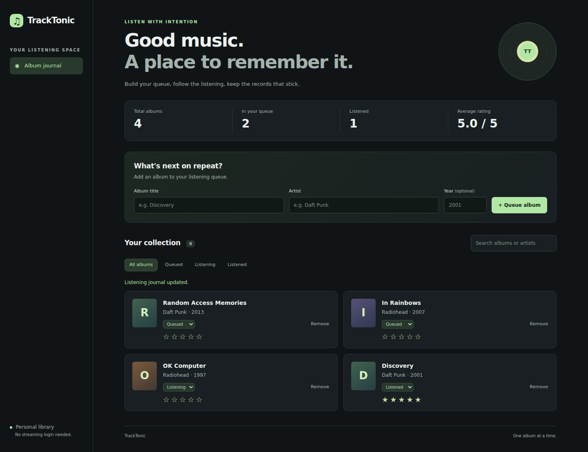
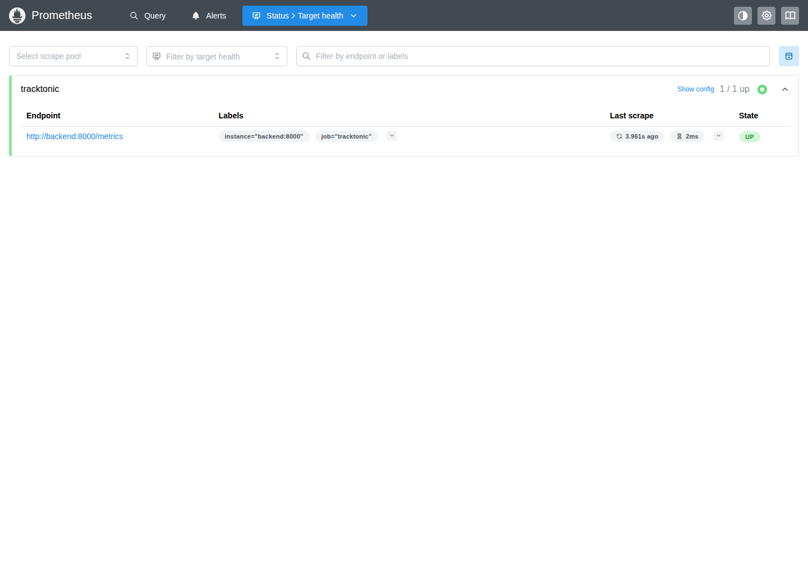
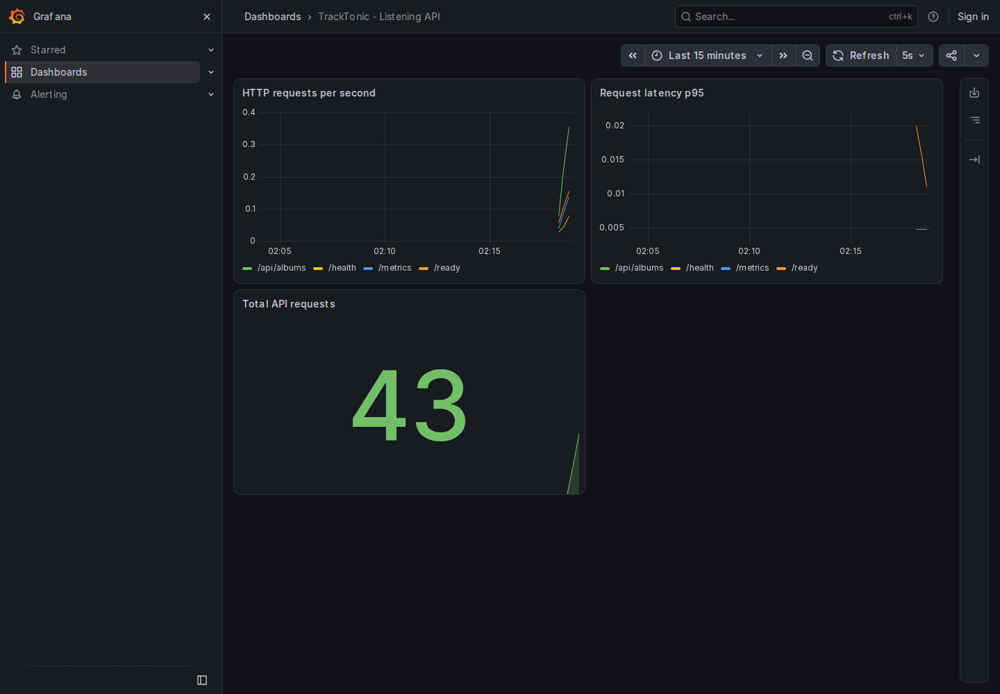

# TrackTonic - Session 21 DevOps Capstone

Rachit · 24BCS10139

TrackTonic is a music listening tracker. You keep albums in a queue, mark the
one you are currently spinning, and log what you have heard with a 1–5 rating.

## Stack

- **Backend** - FastAPI + SQLAlchemy + Alembic, Prometheus metrics on `/metrics`
- **Frontend** - vanilla JS single page served by nginx (responsive desktop + mobile)
- **Database** - PostgreSQL 16
- **Delivery** - Docker, Docker Compose, Helm on kind, GitHub Actions CI/CD publishing to GHCR

## Repository layout

| Path | What it is |
| --- | --- |
| `backend/` | FastAPI app, Alembic migrations, pytest suite, Dockerfile |
| `frontend/` | Static SPA, nginx config, Dockerfile |
| `docker-compose.yml` | One-command local stack with health gating |
| `helm/tracktonic/` | Helm chart: app + Postgres + monitoring |
| `k8s/` | Namespace manifest |
| `monitoring/` | Standalone copies of the Prometheus config and Grafana dashboard |
| `terraform/` | AWS VPC + EKS design |
| `terraform-localstack/` | LocalStack-applied variant of the infra |
| `scripts/runtime-proof.sh` | Full Compose + kind + Helm + browser proof (same script CI runs) |
| `scripts/infra-proof.sh` | Terraform validate + guarded LocalStack lifecycle |
| `scripts/browser-proof.py` | Playwright screenshots (desktop, mobile, Prometheus, Grafana) |

## Run it locally

```bash
docker compose up --build
# UI: http://localhost:3000   API docs: http://localhost:8000/docs
```

Kubernetes (kind + Helm), the same way CI proves it:

```bash
./scripts/runtime-proof.sh
```

## Tests

18 pytest tests, each running against its own isolated database.

```bash
cd backend && python -m pytest -q
```

## CI/CD (`.github/workflows/session21-capstone.yml`)

- **pytest** - the 18-test suite on every push
- **frontend-build** - static build check
- **terraform-local-proof** - `terraform fmt -check`, `init`, `validate` for
  `terraform/`, then `scripts/infra-proof.sh` applies `terraform-localstack/`
  against LocalStack and destroys it again
- **build-scan-publish-demo** - builds both images tagged with the commit SHA,
  runs strict Trivy gates (HIGH + CRITICAL, exit 1), pushes to GHCR, then
  deploys the exact scanned images on a throwaway kind cluster via the Helm
  chart and uploads the evidence as the `tracktonic-proof-<sha>` artifact:
  Compose/kubectl output, Playwright screenshots (desktop, mobile viewports,
  Prometheus targets, Grafana dashboard), Prometheus target and metric-query
  JSON, and a break-and-repair Service/EndpointSlice capture.

### Container hardening

- Backend image is multi-stage: dependencies build into a venv in a build
  stage; the runtime image carries no pip or build tooling and runs as
  uid 10001.
- Frontend image is `nginxinc/nginx-unprivileged`, running as uid 101.
- The Trivy gates use `ignore-unfixed=true`: the current Debian 13.7 base
  carries HIGH CVEs for which no fix has been released, so they cannot be
  remediated by rebuilding. Any vulnerability with an available fix still
  fails the pipeline.

## Infrastructure as code

- `terraform/` - AWS VPC + EKS design; validated locally (`fmt`, `init`, `validate`).
- `terraform-localstack/` - applied locally against LocalStack (`scripts/infra-proof.sh`).

## Kubernetes / Helm

The chart deploys Postgres with a PVC and Secret, a pre-upgrade Alembic
migration Job, an init container that waits for migrations, readiness and
liveness probes, an HPA (2–6 replicas at 70% CPU), an nginx ingress
(`tracktonic.local`), and in-release Prometheus + Grafana with a provisioned
datasource and dashboard.

## Monitoring

Prometheus scrapes `backend:8000/metrics` every 5 s. Grafana ships with the
"TrackTonic Listening API" dashboard (uid `tracktonic`) pre-provisioned and
anonymous read access for demo purposes. Standalone copies of both configs
live in `monitoring/`.

## Demo flow

1. Open the UI and add an album (title, artist, year).
2. Move it queued → listening → listened and give it a rating.
3. Watch it appear in `GET /api/albums` and in the `/metrics` counters.
4. Open the Grafana dashboard to see request rate and latency update.

## Evidence

- Green CI run (all 4 jobs): https://github.com/rachit-suresh/devops-heros/actions/runs/38839345072
  - artifact `tracktonic-proof-71a2e84c373ab48b6bf2c3c2b99912a237addc1b`:
    Compose + kind runtime logs, `kubectl get pods` (all Running), Helm list,
    browser screenshots (desktop, 390px and 320px mobile, Prometheus targets,
    Grafana dashboard), Prometheus targets/metric JSON, and a
    break-and-repair Service/EndpointSlice capture.
  - artifact `tracktonic-local-infra-71a2e84c373ab48b6bf2c3c2b99912a237addc1b`:
    terraform validate + LocalStack apply/destroy log and outputs.
- The same evidence is committed under [`docs/evidence/`](docs/evidence/)
  (copied from those artifacts), so it renders without CI access:








  - Mobile viewports: [390px](docs/evidence/kubernetes-mobile-390.png),
    [320px](docs/evidence/kubernetes-mobile-320.png) (Compose equivalents:
    [390px](docs/evidence/compose-mobile-390.png),
    [320px](docs/evidence/compose-mobile-320.png))
  - Cluster state: [pods.txt](docs/evidence/pods.txt) (all Running),
    [services.txt](docs/evidence/services.txt),
    [helm.txt](docs/evidence/helm.txt),
    [ingress-hpa.txt](docs/evidence/ingress-hpa.txt),
    [postgres.txt](docs/evidence/postgres.txt)
  - Full logs: [compose.txt](docs/evidence/compose.txt),
    [runtime.log](docs/evidence/runtime.log)
  - Monitoring data: [prometheus-targets.json](docs/evidence/prometheus-targets.json),
    [metric-query.json](docs/evidence/metric-query.json),
    browser checks ([Compose](docs/evidence/compose-browser-checks.json),
    [kind](docs/evidence/kubernetes-browser-checks.json))
  - Break-and-repair: [service-broken.yaml](docs/evidence/service-broken.yaml),
    [service-repaired.yaml](docs/evidence/service-repaired.yaml)
  - Terraform/LocalStack: [terraform.log](docs/evidence/terraform.log),
    [localstack-outputs.json](docs/evidence/localstack-outputs.json),
    [localstack-empty-state.txt](docs/evidence/localstack-empty-state.txt)
- Images: `ghcr.io/rachit-suresh/tracktonic-backend:71a2e84c373ab48b6bf2c3c2b99912a237addc1b`
  and `ghcr.io/rachit-suresh/tracktonic-frontend:71a2e84c373ab48b6bf2c3c2b99912a237addc1b`
  (SHA-tagged, Trivy-scanned before publish; later commits publish their own SHA tags).
